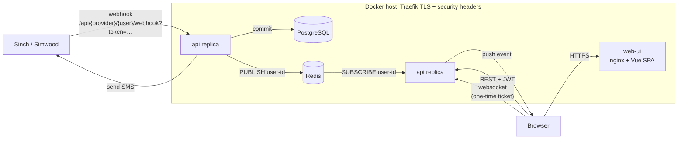
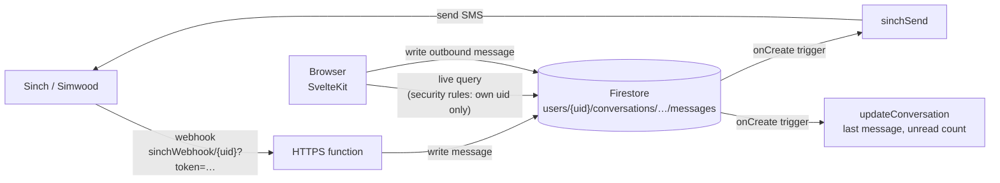

# LiveSMS

A web inbox for two-way SMS. Messages to and from a business number appear as
real-time conversation threads in the browser, with Sinch and Simwood as the
SMS carriers.

I built the same product twice, two ways:

| | [`v1-selfhosted/`](v1-selfhosted) (2020) | [`v2-firebase/`](v2-firebase) (2021–2024) |
|---|---|---|
| Approach | Self-developed services on my own Docker host | Managed platform services (Firebase) |
| API / backend | FastAPI (async Python), SQLAlchemy, Alembic | Cloud Functions (TypeScript), Firestore triggers |
| Data | PostgreSQL | Firestore |
| Real-time updates | Redis pub/sub → websocket fan-out | Firestore live queries |
| Auth | Own JWTs (RS256, rotating keys in Redis, JWKS endpoint) | Firebase Authentication + Firestore security rules |
| Frontend | Vue 2 + TypeScript + Tailwind, served by nginx | SvelteKit + Tailwind, Firebase Hosting |
| Build / deploy | GitLab CI: Kaniko image builds, tag-driven release, remote `docker-compose` deploy behind Traefik | `firebase deploy` |
| Carriers | Sinch and Simwood behind a common provider interface | Sinch (send and receive), Simwood (receive) |
| Things I run | API, Postgres, Redis, nginx, Traefik, CI runners | Nothing |

> **Status: archived / portfolio.** Both versions are sanitised snapshots of
> private GitLab repositories, with squashed history. Neither is running today.

## v1: self-hosted



How it works:

- **Fan-out works across replicas.** SQLAlchemy `after_insert`/`after_update`/`after_delete`
  hooks on conversations and messages publish an event to a Redis channel named
  after the user. Each API process subscribes only to the channels of users with
  a websocket open on that process (`sms/views.py`, `ConnectionManager`). A
  webhook can land on any replica and the browser connected to another replica
  still updates live, so the API stays stateless and can scale horizontally.
- **Websocket auth uses one-time tickets.** Browsers can't send an
  `Authorization` header on a websocket, so the client exchanges its JWT for a
  random ticket. The ticket is stored in Redis for 10 seconds and bound to the
  client IP, and it's what opens the socket. The long-lived token never goes
  into a URL.
- **Token signing uses rotating keys.** RS256 key pairs are generated on demand
  and rotated daily, with the private key held in Redis. The public keys are
  published at `/api/auth/jwks`, keeping the previous key so tokens still verify
  across a rotation. Access tokens last 5 minutes; refresh tokens last 1 day.
- **Carriers sit behind one interface.** `providers/sinch.py` and
  `providers/simwood.py` each implement an inbound webhook model and a
  `send_message`. Each user chooses their carrier and enters their own API
  credentials.
- **Delivery pipeline:** every push to `master` builds `:latest`, and a `v*`
  tag builds `:stable`. Both `api` and `web-ui` build their images in GitLab CI
  with Kaniko, so no Docker daemon or privileged runner is needed. A tag
  triggers the `deploy` project, which runs `docker-compose up` on the host
  over `DOCKER_HOST=ssh://…`. Traefik routes by host and path and adds HSTS
  and frame-deny headers.

## v2: Firebase



The same features, with almost all of the infrastructure handed to Firebase:

- **Live queries replace the websocket and Redis.**
- **Firebase Auth and security rules replace JWT handling.** One rule
  (`users/{uid}/**` is readable and writable only by that `uid`) does the job
  of v1's per-query ownership checks.
- **Firestore triggers replace the ORM hooks.** Writing an outbound message
  document *is* the send request: a trigger calls Sinch, and another updates
  the conversation summary.

**Trade-offs:**
- **v2 gains:** no servers, databases or CI runners to patch, scale or back up.
  It's also far less code.
- **v2 gives up:** portability. It's tied to Firebase. Local work depends on
  the emulator suite, and the data model has to suit Firestore's query
  limitations: for example, the unread count is denormalised onto the
  conversation, where v1 computes it in SQL.

## Running it

**v1:** the images expect `DB_URL` and `REDIS_URL`. `api/prestart.sh` runs
the Alembic migrations on start-up. `deploy/docker-compose.yml` shows the
production layout, which needs `LIVESMS_HOST` and `DB_PASSWORD`. The deploy
pipeline also needs `DEPLOY_HOST`, `DEPLOY_PROJECT_ID` and `WEBHOOK_TOKEN`.

**v2:** copy `v2-firebase/.env.example` to `.env`, fill it in from your
Firebase project, and set the project in `.firebaserc`. Then:

```sh
npm install && (cd functions && npm install)
firebase emulators:start     # auth, firestore, functions, hosting
npm run dev
```

## Sanitisation and fixes made for publication

- **History:** squashed. The private repos had 28 commits in total.
- **Configuration:** production hostnames, the Docker host, the GitLab project
  ID and the Firebase project config are now environment variables or
  placeholders. A database password hard-coded in `alembic.ini` was removed.
- **Webhooks (both versions):** they accepted posts for any user ID, with no
  check on the sender. Each user now has a random `webhook_token`, which must
  be in the webhook URL and is compared in constant time; an unknown user and
  a bad token give the same 404. v1 adds an Alembic migration that backfills
  tokens for existing users. v2's functions also now respond to bad requests
  instead of leaving them hanging until timeout.
- **v1 migrations:** `migrations/env.py` assigned `DB_URL` to an engine that
  had already been created, which has no effect. So migrations actually ran
  against the URL hard-coded in `alembic.ini`, which is why that file held a
  real password. The URL is now set before the engine is built.
- **v1 first login:** it failed on an empty Redis, because the signing key was
  only generated when a token was *verified*. `create_token` now makes sure
  the key exists first.

- **v1 websocket tickets:** the ticket's default value was evaluated once, when
  the module loaded, so every ticket from a process was identical and could
  be reused. Each ticket is now a fresh random value, and it's read and
  deleted from Redis in one transaction, so it works only once.
- **v2 login redirect:** `?next=` was passed straight to `goto()`, which
  allowed redirects off-site and `javascript:` URLs. Only same-origin paths
  are now followed.

### Known limitations (left as-is)

- **Credentials:** carrier API credentials are stored in plain text, in
  Postgres and Firestore respectively.
- **Sending:** outbound sends are fire-and-forget, with no retry or
  delivery-receipt handling.
- **Tests:** neither version has automated tests. The fixes above were checked
  against Postgres and Redis containers: migrations up from the original
  schema, webhook accepted and rejected cases, login, and settings round-trip.
  The v2 functions were checked with a TypeScript compile only.
